# AI Invoice Automation

Upload a PDF invoice to a OneDrive folder. AI reads it, the details land in an Excel table, any invoice over $1,000 waits for a person to approve or reject it, and a summary email goes out when it is done. Nobody types invoice data by hand.

Built with Azure Logic Apps, Azure AI Document Intelligence, OneDrive for Business, Power Automate, Excel Online and Outlook.

## The problem

Small offices and student clubs often pay bills from emailed PDF invoices. Someone opens each PDF, copies the vendor, invoice number, due date and amount into a spreadsheet, and then chases a manager to sign off on the big ones. It is slow, it is easy to make typos, and there is no record of who approved what.

## What it does

1. You drop a PDF invoice into the OneDrive folder `/Invoices/Incoming`.
2. An AI model reads the invoice and pulls out the **vendor**, **invoice number**, **due date**, **amount** and a **confidence score**.
3. A new row is added to an Excel table with Status **Pending**.
4. If the amount is **over $1,000**, an approval request is sent. The approver clicks **Approve** or **Reject** in Outlook or the Power Automate Approvals page, and the row is updated to match.
5. If the amount is **$1,000 or less**, the row is marked **Approved** automatically.
6. A summary email is sent with the invoice details.

## Architecture

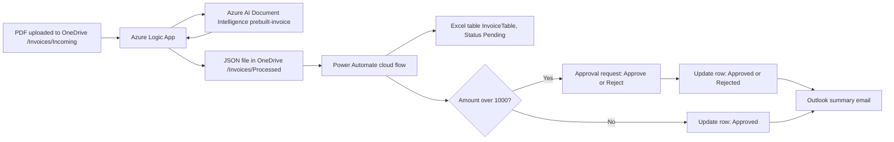

### Why it is split across two tools

My university Microsoft 365 tenant requires admin consent before an Azure Logic App can use the Excel Online connector. Power Automate is a first-party tool inside the same tenant, so it can write to Excel without that approval. So the work is split:

- **Azure Logic App** (personal Azure for Students subscription): reads the PDF with AI and saves the results as a small JSON file in OneDrive.
- **Power Automate** (university Microsoft 365 account): picks up each JSON file and does everything that touches Excel, approvals and email.

The JSON file in `/Invoices/Processed` is the hand-off point between the two. It also leaves a record of exactly what the AI read from each invoice.

## How it works, step by step

### Part 1: Azure Logic App (Consumption plan)

| Step | What it does |
|---|---|
| **When a file is created** (OneDrive for Business, properties only) | Checks `/Invoices/Incoming` every few minutes for new PDFs |
| **Get file content** (OneDrive for Business) | Downloads the PDF bytes |
| **Analyze Document** (Azure AI Document Intelligence, model `prebuilt-invoice`, API version `2024-11-30`) | Reads the invoice and returns structured fields |
| **For each** document | Loops over the invoices the AI found (one per PDF here) |
| **Compose** with `setProperty` | Builds a clean JSON object: Vendor, InvoiceId, DueDate, Amount, Confidence |
| **Create file** (OneDrive for Business) | Saves it as `INV-1002_20261018221501.json` in `/Invoices/Processed` |

Example of a file it writes:

```json
{"Vendor":"Lakeshore Cloud Hosting Inc.","InvoiceId":"INV-1002","DueDate":"2026-11-02","Amount":1384.25,"Confidence":0.43}
```

### Part 2: Power Automate cloud flow

| Step | What it does |
|---|---|
| **When a file is created** (OneDrive for Business) | Fires for each new JSON file in `/Invoices/Processed` |
| **Parse JSON** | Turns the file into fields the flow can use |
| **Add a row into a table** (Excel Online Business) | Adds the invoice to `InvoiceTable` with Status `Pending` |
| **Condition**: Amount greater than 1000 | Decides if a person needs to look at it |
| True: **Start and wait for an approval** (Approve/Reject) | Sends the approval request and waits for an answer |
| True: nested **Condition** on the outcome | **Update a row** to `Approved` or `Rejected`, matched on InvoiceId |
| False: **Update a row** | Marks the invoice `Approved` automatically |
| **Send an email (V2)** (Office 365 Outlook) | Sends a summary with vendor, amount, due date and AI confidence |

## Screenshots

**The finished Excel table after all five test invoices**

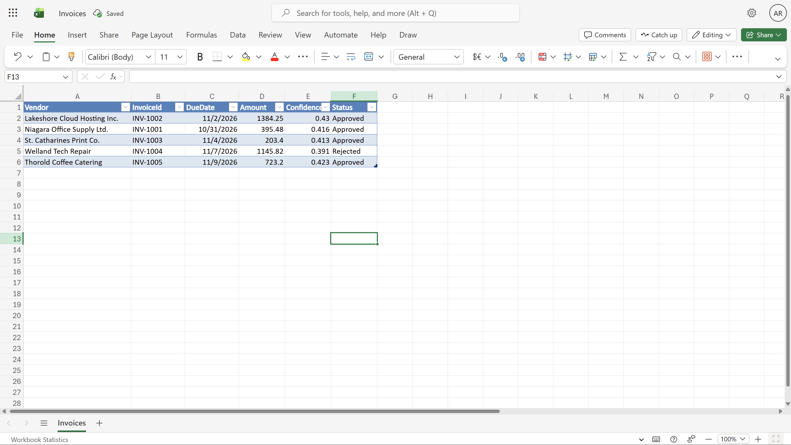

**First successful run: INV-1002 approved and written to Excel**

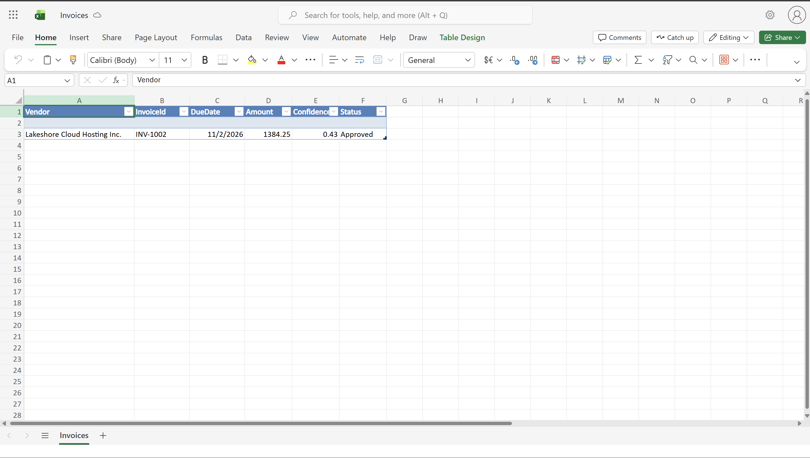

**The Power Automate flow design, with the approval branch and the nested Approve/Reject condition**

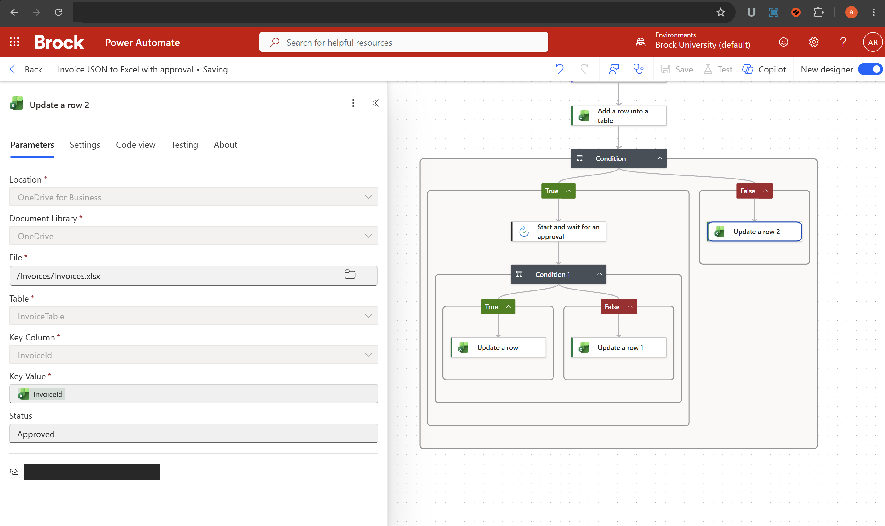

**A full green run from trigger to summary email**

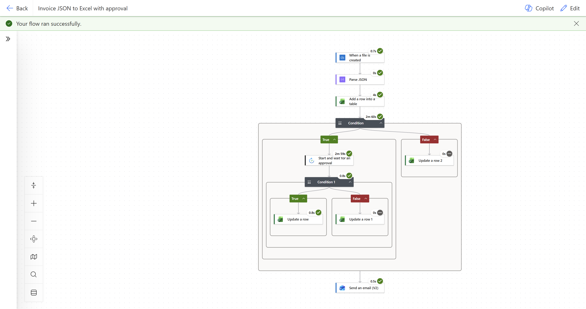

**The approval request for INV-1004 ($1,145.82), being rejected**

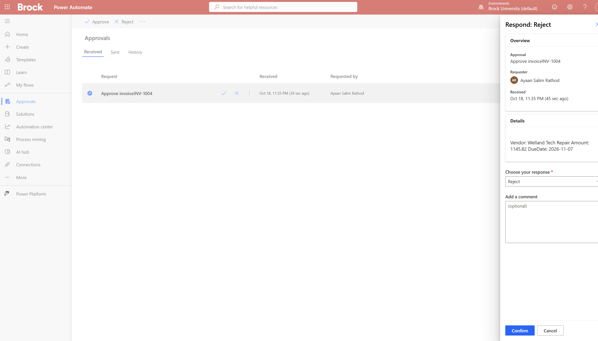

**The summary email sent after the rejection**

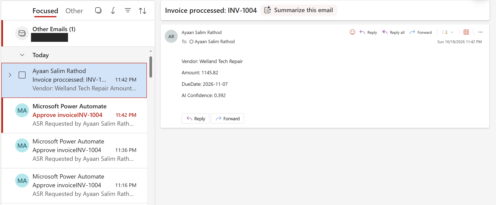

Some screenshots have small dark boxes. Those hide email addresses, internal IDs and the browser address bar.

## Test results

I tested the pipeline with five sample invoices (generated PDFs, in [`sample_invoices/`](sample_invoices/)). A clean copy of the final table is in [`data/Invoices_sample.xlsx`](data/Invoices_sample.xlsx).

| Vendor | InvoiceId | DueDate | Amount | Confidence | Status | How it got there |
|---|---|---|---:|---:|---|---|
| Lakeshore Cloud Hosting Inc. | INV-1002 | 2026-11-02 | 1,384.25 | 0.43 | Approved | Over $1,000, approved by me |
| Niagara Office Supply Ltd. | INV-1001 | 2026-10-31 | 395.48 | 0.416 | Approved | Auto-approved |
| St. Catharines Print Co. | INV-1003 | 2026-11-04 | 203.40 | 0.413 | Approved | Auto-approved |
| Welland Tech Repair | INV-1004 | 2026-11-07 | 1,145.82 | 0.391 | Rejected | Over $1,000, rejected by me |
| Thorold Coffee Catering | INV-1005 | 2026-11-09 | 723.20 | 0.423 | Approved | Auto-approved |
| **Total** | | | **3,852.15** | | | |

All five vendors, invoice numbers, due dates and amounts were read correctly. Both paths of the approval branch (Approve and Reject) and the auto-approve path were tested.

The confidence score is the AI's confidence in the amount field. It came out low (about 0.4) on these simple generated PDFs even though every value was right, so I would not use it alone to skip human review.

## Challenges and fixes

**1. Region blocked by policy.** Creating the Document Intelligence resource in Canada Central failed because the Azure for Students subscription only allows certain regions. I checked the allowed regions and deployed it, and the Logic App, in East US.

**2. "BadRequest" from the AI step because the file content was missing.** The PDF bytes were not reaching Document Intelligence. I changed the trigger to the properties-only version and added a separate **Get file content** step, then passed its output to the AI step.

**3. Excel connector blocked in the Logic App.** The university tenant asked for admin consent. I moved all Excel work into Power Automate and used a JSON file in OneDrive as the hand-off (see "Why it is split across two tools").

**4. A rejection did not reach Excel.** The approval history showed INV-1004 as Rejected, but the run failed at **Update a row 1** with `NotFound`.

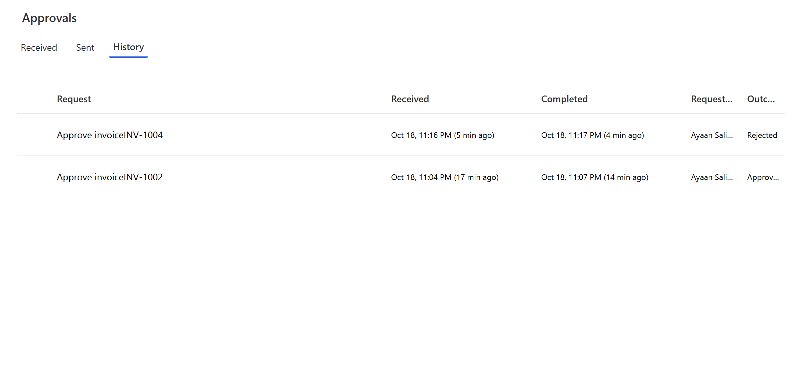
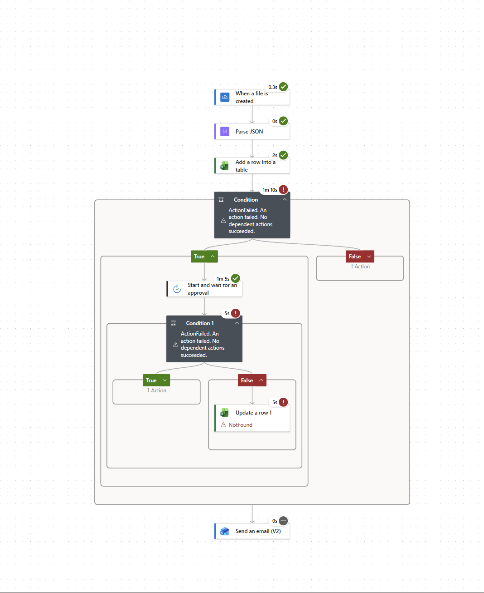

**5. The summary emails were empty.** The email inputs showed `Vendor:` with no value after it.

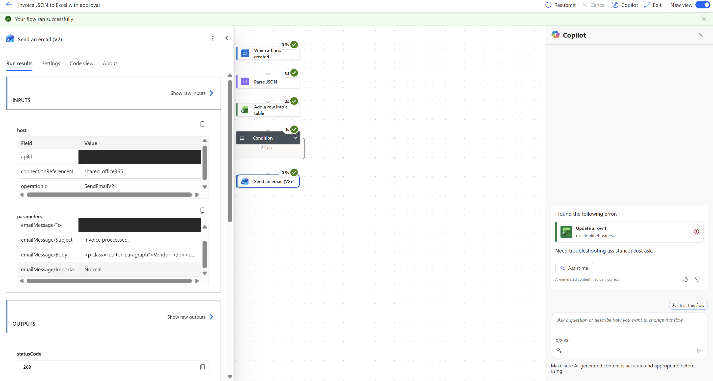

The values in the email (and the Update a row key) came from the **Add a row into a table** step's output, shown by the green Excel icons. That output came back blank. I replaced them with expressions that read straight from Parse JSON, for example `body('Parse_JSON')?['InvoiceId']`.

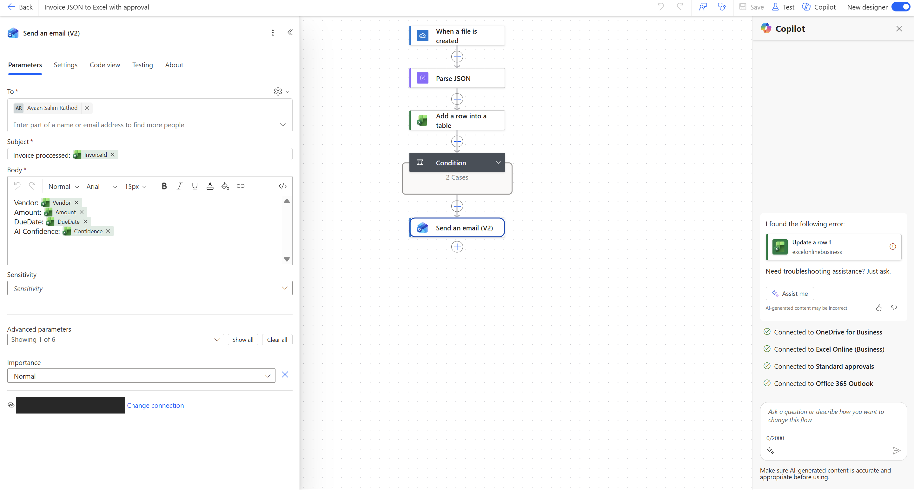

**6. Update a row still said "No row was found with Id INV-1004".** The invoice number was right now, so I checked the step's inputs. The key column (`idColumn`) was set to **Status** instead of **InvoiceId**, so it was searching the Status column for "INV-1004". Changing it to InvoiceId fixed it, and I resubmitted the failed run.

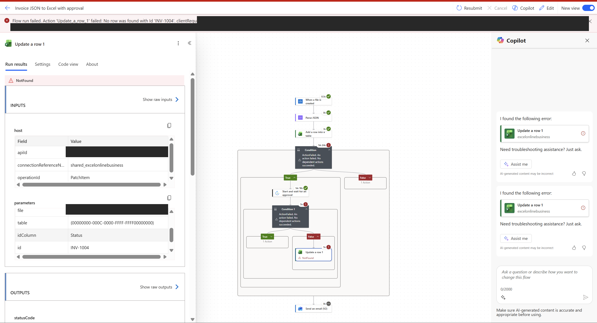

**7. Duplicate rows from testing.** Re-uploading the same invoice while debugging created extra INV-1004 rows. **Update a row** only changes the first matching row, so the duplicates stayed Pending. I deleted them by hand. A real version should check for an existing InvoiceId before adding a row.

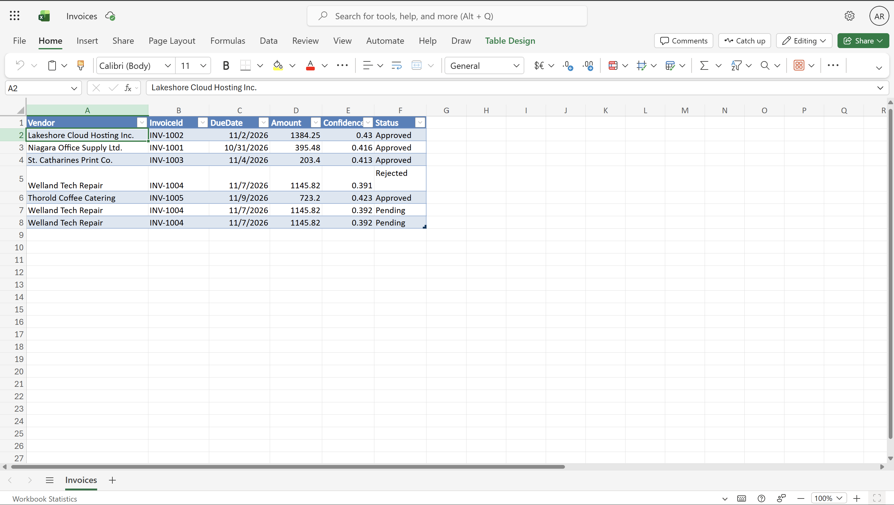

## How to rebuild it

Short version:

1. Create an Azure AI Document Intelligence resource (Free F0 tier) in a region your subscription allows.
2. In OneDrive for Business, create `/Invoices/Incoming`, `/Invoices/Processed` and `/Invoices/Invoices.xlsx` with a table named `InvoiceTable` (columns Vendor, InvoiceId, DueDate, Amount, Confidence, Status).
3. Build the Logic App: OneDrive trigger, Get file content, Analyze Document (`prebuilt-invoice`), For each, Compose, Create file.
4. Build the Power Automate flow: OneDrive trigger on Processed, Parse JSON, Add a row, Condition, approval, Update a row, Send an email.
5. Upload a sample invoice from `sample_invoices/` and watch it run.

The full click-by-click guide with every expression is in [docs/SETUP.md](docs/SETUP.md). Exported workflow files will go in [workflows/](workflows/).

## What I learned

- How to call a prebuilt AI model from a low-code workflow and turn its nested output into a simple record.
- How to read run history and step inputs to find the real cause of a failure, not just the error message.
- Where dynamic content comes from matters. A value that looks right in the designer can come from the wrong step and be blank at run time.
- How tenant permissions and region policies shape the design, and how to work around them with tools that are already allowed.
- Testing every branch (approve, reject, auto-approve) catches bugs that a single happy-path test misses.

## Next steps

- **Next: Power BI dashboard** on the Excel table (total spend, spend by vendor, upcoming due dates, invoices waiting for approval).
- Skip duplicate invoices by checking for an existing InvoiceId before adding a row.
- Send low-confidence or incomplete invoices to review even when they are under $1,000.
- Small fixes: add a space in the approval title ("Approve invoice INV-1004") and fix the "proccessed" typo in the email subject.

## Repo layout

```
ai-invoice-automation/
  README.md
  LICENSE
  docs/SETUP.md               full build guide
  data/Invoices_sample.xlsx   clean copy of the final table
  sample_invoices/            five test PDFs (INV-1001 to INV-1005)
  screenshots/                results and debugging screenshots
  workflows/                  Logic App JSON and Power Automate export (coming soon)
```

## License

MIT. See [LICENSE](LICENSE).
